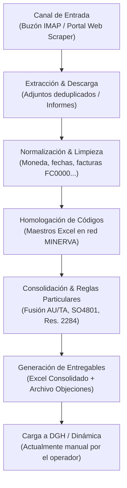
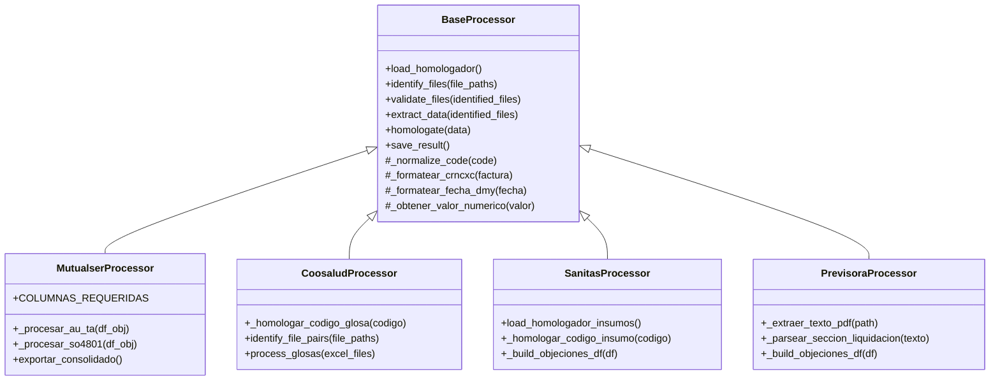

# Glosaap — Documento Integral de Funcionalidades, Arquitectura y Reglas de Negocio por EPS

> **Versión del documento:** v0.11.34  
> **Fecha:** 2026-11-13  
> **Área:** Cartera / Glosas — Clínica La Concepción  
> **Propósito:** Manual técnico y funcional exhaustivo de referencia sobre el comportamiento, arquitectura, módulos, herramientas y reglas de procesamiento de cada EPS en **Glosaap**.

---

## 1. Visión General del Sistema

**Glosaap** es una aplicación de escritorio moderna desarrollada para el sistema operativo Windows (Python 3.11 + Flet), orientada a automatizar, estandarizar y acelerar el ciclo operativo de procesamiento de glosas médicas emitidas por Entidades Promotoras de Salud (EPS) y aseguradoras colombianas a la Clínica La Concepción.

### 1.1 El Problema Operativo que Resuelve
1. **Dispersión de canales:** Notificaciones recibidas por correo electrónico (IMAP) o plataformas web propietarias (Horus/Fomag, Familiar).
2. **Formatos heterogéneos:** Archivos Excel estructurados, reportes pareados (Detalle + Glosa), tablas sin cabeceras estandarizadas, o documentos PDF de liquidación con tablas complejas.
3. **Disparidad de catálogos (Codificación):** Los códigos facturados por la IPS/ERP difieren sustancialmente de la codificación requerida por el sistema hospitalario central (**Dinámica Gerencial Hospitalaria / DGH**).
4. **Reglas de liquidación particulares:** Resoluciones ministeriales (ej. Res. 2284), fusiones de conceptos (`AU` con `TA`), absorciones de servicios (`SO4801`), y casuística de insumos hospitalarios (CUM / IUM RDA).
5. **Generación manual de archivos de carga:** Necesidad de estructurar un layout estricto de 15 columnas exigido por Dinámica para registrar las objeciones en el módulo contable/cartera.

### 1.2 Ciclo de Vida del Dato en Glosaap

---

## 2. Arquitectura de la Aplicación

### 2.1 Stack Tecnológico
- **Lenguaje:** Python 3.11.9 (ejecutado en entorno virtual `.venv`).
- **Interfaz Gráfica (GUI):** Flet 0.27.6 + `flet-desktop` 0.27.6 (Flutter engine compilado). Soporte reactivo de temas Claro y Oscuro con `ThemeManager`.
- **Procesamiento de Datos:** `pandas`, `openpyxl`.
- **Extracción de Documentos:** `pypdf` (extracción y parseo de texto tabular en PDFs).
- **Automatización Web:** `playwright` con persistencia de perfiles y fallback inteligente a Google Chrome / Microsoft Edge del sistema o autoinstalación en primer uso.
- **Seguridad y Credenciales:** `keyring`, Windows Credential Manager (DPAPI), cifrado local seguro para sesiones recordadas.
- **Empaquetado y Distribución:** PyInstaller 6.22.3 (single executable con auto-bootloader), Inno Setup 6 (instalador por usuario sin privilegios de administrador), y actualizador integrado (`updater.py`) con verificación criptográfica SHA-256.

### 2.2 Rutas y Almacenamiento Centralizado
Toda la configuración de red y rutas reside únicamente en `app/config/settings.py`:
- **Servidor Corporativo Base:** `\\MINERVA\Cartera\GLOSAAP`
- **Carpeta de Homologadores:** `\\MINERVA\Cartera\GLOSAAP\HOMOLOGADOR`
- **Repositorios de Resultados:**
  - `\\MINERVA\Cartera\GLOSAAP\REPOSITORIO DE RESULTADOS\MUTUALSER`
  - `\\MINERVA\Cartera\GLOSAAP\REPOSITORIO DE RESULTADOS\COOSALUD`
  - `\\MINERVA\Cartera\GLOSAAP\REPOSITORIO DE RESULTADOS\SANITAS`
  - `\\MINERVA\Cartera\GLOSAAP\REPOSITORIO DE RESULTADOS\PREVISORA`
  - `\\MINERVA\Cartera\GLOSAAP\RESULTADO DE GLOSA WEB` (Descargas Fomag / Familiar)
- **Modo Desconectado / Fallback:** Si el recurso compartido de red no está accesible (`is_network_available() == False`), el sistema conmuta automáticamente a `%TEMP%\glosaap` o al Escritorio del usuario sin interrumpir la operación ni bloquear la interfaz.

---

## 3. Módulos y Funcionalidades del Sistema

### 3.1 Módulo de Autenticación IMAP
- **Detección Automática de Servidores:** Al ingresar el correo (ej. `@laconcepcion.org`, `@gmail.com`, `@outlook.com`), el cliente mapea automáticamente el host IMAP y puerto seguro (SSL 993).
- **Recordatorio Seguro:** Guarda credenciales mediante el gestor de contraseñas de Windows (DPAPI/Keyring).
- **Validación de Conexión:** Verifica credenciales en tiempo real antes de permitir el ingreso al Dashboard.

### 3.2 Selección de Método de Trabajo
- **Vía Correo Electrónico:** Flujo estándar para EPS que remiten notificaciones periódicas a buzones institucionales.
- **Vía Descarga Web:** Acceso a portales transaccionales que no envían correos sino que requieren extracción directa (Fomag / Familiar).

### 3.3 Flujo Principal: "Manejar Glosa"
Estructurado visualmente mediante una **Cinta de Pasos Guiada**:
$$\text{Buscar} \longrightarrow \text{Descargar} \longrightarrow \text{Procesar} \longrightarrow \text{Revisar}$$

1. **Filtro de Fechas Obligatorio:** Selección de fecha "Desde" y "Hasta". Es una precondición obligatoria antes de disparar la búsqueda de cualquier EPS.
2. **Búsqueda Eficiente IMAP:** Consulta los encabezados del servidor sin transferir el cuerpo completo del mensaje, aplicando filtros específicos de remitente y asunto.
3. **Descarga Deduplicada:** Los adjuntos se transfieren a un entorno temporal asociando como metadato la fecha real de recepción del correo (imprescindible para el registro de objeción). Se previene la descarga duplicada mediante control de Message-ID.
4. **Procesamiento de Archivos:** Ejecución del procesador correspondiente (Template Method) con visualización de progreso y barra de estado. Soporta cancelación interactiva.
5. **Diálogo de Resultados y Acciones Rápidas:**
   - Visualización de estadísticas: total registros, facturas únicas, homologados y no homologados.
   - Botón directo para **Abrir Carpeta de Destino** en el Explorador de Windows.
   - Botón directo para **Ver No Homologados**, permitiendo identificar qué códigos deben ingresarse al maestro de homologación.

### 3.4 Sistema de Guías y Ayuda Interactiva (`?`)
- **Tour de Bienvenida:** Se dispara en el primer inicio de sesión del usuario explicando las etapas operativas, con opción "No volver a mostrar".
- **Botón `?` por Pantalla:** Presente en Dashboard, EPS, Mensajes, Herramientas, Homologación, etc. Despliega una tarjeta flotante no modal que no interrumpe la navegación.
- **Botón `?` por EPS:** Ubicado tanto en cada tarjeta de EPS en la pantalla de selección como al lado del botón "Procesar", permitiendo consultar en cualquier momento las reglas de negocio exactas de la entidad.
- **Focus Guiado (Efecto Pulse):** Al solicitar ayuda en la vista de correos, la app parpadea visualmente la cinta de pasos y el botón de procesar para orientar al usuario.

### 3.5 Módulo de Herramientas
1. **Gestión de Homologación:**
   - Visualización y búsqueda rápida de códigos por EPS.
   - Pestaña de registro individual de códigos.
   - Pestaña de **Carga Masiva** mediante archivo Excel, con tabla previa de verificación de duplicados, errores y nuevos registros.
   - Sistema de **Backups Automáticos:** Antes de modificar cualquier archivo maestro en `\\MINERVA`, se crea una copia fechada en la carpeta `backup/`.
   - Soporte agrupado especial para Sanitas (permite gestionar independientemente la tabla **Normal** y la tabla **Insumos**).
2. **Homologador Manual:**
   - Permite cargar cualquier archivo Excel externo arbitrario, elegir qué columna contiene el código de tecnología/servicio y aplicar la homologación directa de la EPS seleccionada.
3. **Mix Excel:**
   - Herramienta de cruce de datos: carga dos hojas de cálculo (origen y destino), mapea columnas por llave común con tolerancia y transfiere campos.

### 3.6 Módulo de Descarga Web
- **Familiar de Colombia:** Conexión automatizada al portal SIE (`loginIps.xhtml`), ingreso de NIT, usuario y contraseña, navegación al módulo de glosas, filtrado por fechas y descarga del consolidado.
- **Fomag (Portal Horus):** Automatización mediante Playwright del nuevo módulo *Cuentas Médicas → Informe Prestador*.
  - Apertura con navegador visible (`headless=False`) para resolución manual del CAPTCHA.
  - Selección de reporte de **Trazabilidad** en formato **Excel**.
  - **Partición Automática por Tramos:** Dado que el portal Horus impone un límite de consulta de máximo 14 días calendario, si el usuario define un rango amplio (ej. 2 o 3 meses), Glosaap fragmenta el rango en lotes consecutivos de hasta 14 días y descarga todos los archivos de manera secuencial sin intervención adicional.
  - **Compatibilidad de Navegadores:** Fallback automático para ejecutar sobre Google Chrome o Microsoft Edge ya instalados en el equipo, o autodescarga en segundo plano de Chromium sin requerir comandos de consola ni privilegios administrativos.

---

## 4. Estructura Estándar del Archivo de Objeciones (DGH)

Para que el archivo generado sea apto para la carga en Dinámica Gerencial Hospitalaria, todas las EPS habilitadas comparten la misma estructura canónica de **15 columnas**:

| N° | Columna | Tipo / Formato | Descripción / Regla |
|:--:|:---|:---|:---|
| 1 | `CDCONSEC` | Entero consecutivo | Secuencia numérica incremental por factura única (1, 2, 3...) |
| 2 | `CDFECDOC` | Fecha (`D/M/A` o `DD/MM/YYYY`) | Fecha de elaboración del documento (fecha actual del sistema) |
| 3 | `CRNCXC` | Texto (`FC0000{dígitos}`) | Número de cuenta médica/factura normalizada con prefijo `FC0000` |
| 4 | `CROFECOBJ` | Fecha (`DD/MM/YYYY`) | Fecha en que la EPS notificó la objeción (tomada del correo o reporte) |
| 5 | `CROREFERE` | Texto | Campo referencial (generalmente vacío) |
| 6 | `CROOBSERV` | Texto | Observación a nivel de factura o radicado de glosa |
| 7 | `CROCLAOBJ` | Numérico (`0`) | Clase de objeción (valor por defecto 0) |
| 8 | `CRNCLAOBJ` | Texto / Vacío | Clasificación secundaria de objeción (vacío en Sanitas y estándar) |
| 9 | `GENUSUARIO4` | Numérico (`1103858268`) | Identificador del usuario auditor/responsable |
| 10 | `CRNCONOBJ` | Texto (Código Glosa) | Concepto/código de la glosa normalizado |
| 11 | `SLNSERPRO` | Texto (Código Servicio) | Código homologado DGH del servicio/tecnología médica |
| 12 | `CTNCENCOS` | Texto / Vacío | Centro de costos (generalmente vacío para asignación en DGH) |
| 13 | `IDRIPS` | Texto / Vacío | Identificador RIPS (vacío) |
| 14 | `CROVALOBJ` | Numérico Decimal | Valor monetario objetado (número puro sin símbolos ni puntos de miles) |
| 15 | `CRDOBSERV` | Texto | Justificación u observación detallada del motivo de la glosa |

---

## 5. Reglas de Negocio Detalladas por EPS

---

### 5.1 Mutualser EPS

- **Estado:** Habilitada.
- **Canal de Búsqueda IMAP:**
  - Asunto: `Objeciones de glosa Factura FC`
  - Filtro: `mutualser`
- **Archivos de Entrada:** Adjuntos Excel o CSV (`.xlsx`, `.xls`, `.xlsm`, `.xlsb`, `.csv`).
- **Homologador:** `\\MINERVA\Cartera\GLOSAAP\HOMOLOGADOR\mutualser_homologacion.xlsx`
- **Directorio de Salida:** `\\MINERVA\Cartera\GLOSAAP\REPOSITORIO DE RESULTADOS\MUTUALSER`

#### Reglas de Procesamiento:
1. **Detección de Tablas:** Localiza dinámicamente la fila de encabezados que contenga `NUMERO DE FACTURA` o `DETALLE DE GLOSA`. Extrae fechas documentales del encabezado si existen.
2. **Depuración de Registros:** Descarta automáticamente filas sin número de factura o filas de resumen que contengan textos como `TOTAL` o `SUMA`.
3. **Mapeo de Homologación:**
   - Cruza la columna `Tecnología` con el maestro de homologación buscando en la columna `Código Servicio de la ERP`.
   - Recupera el código equivalente en `Código producto en DGH`.
   - Valida que dicho código exista efectivamente en el catálogo `COD_SERV_FACT`. Si no existe coincidencia, conserva el campo vacío y marca el registro como no homologado.
4. **Regla de Formateo de Facturas (`CRNCXC`):**
   - Transforma valores numéricos o alfanuméricos mediante la función `_formatear_crncxc()`, asegurando el formato canónico `FC0000{dígitos}` (ej. `51234` $\rightarrow$ `FC000051234`).
5. **Regla de Fusión AU y TA:**
   - Si para una misma factura (`CRNCXC`) y un mismo servicio (`SLNSERPRO`), existen múltiples glosas donde una inicia por `AU` (Auditoría) y otra por `TA` (Tarifas):
   - Se conserva la fila con código `AU`.
   - Las observaciones (`CRDOBSERV`) se combinan mediante el separador ` // ` (ej. `Obs AU // Obs TA`).
   - La fila redundante de `TA` se elimina del archivo final de objeciones.
6. **Regla de Absorción por `SO4801`:**
   - Si dentro del grupo (misma factura y mismo servicio) existe el concepto prioritario `SO4801`:
   - Este código prevalece de forma absoluta.
   - Las observaciones de los demás conceptos concurrentes se absorben dentro de la fila `SO4801` concatenadas con ` // `.
   - Las filas correspondientes a los otros conceptos se suprimen.
7. **Tratamiento Numérico (`CROVALOBJ`):**
   - El parser `_obtener_valor_numerico()` limpia símbolos monetarios (`$`), espacios y formatos con punto como separador de miles. Valores como `"$ 3.404"` se convierten estrictamente a `3404` y no al decimal `3.404`.
8. **Archivos Generados:**
   - Consolidado general: `MUTUALSER_consolidado_YYYYMMDD_HHMMSS.xlsx`
   - Archivo de carga: `Objeciones_YYYYMMDD_HHMMSS.xlsx`

---

### 5.2 Coosalud EPS

- **Estado:** Habilitada.
- **Canal de Búsqueda IMAP:**
  - Asunto: `Reporte Glosas y Devoluciones`
  - Filtro: `coosalud`
- **Archivos de Entrada:** Pares de archivos Excel por cada factura:
  - Archivo 1: `DETALLE FC{numero}.xlsx` (contiene la columna `codigo_servicio` a homologar).
  - Archivo 2: `GLOSAS FC{numero}.xlsx` (contiene la columna `codigo_glosa`).
  - *Archivos de devolución:* Aquellos cuyo nombre incluya `DEVOLUCION` o `DEVOLUCIÓN` se identifican y descartan de forma automática.
- **Homologador:** `\\MINERVA\Cartera\GLOSAAP\HOMOLOGADOR\coosalud_homologacion.xlsx`
- **Directorio de Salida:** `\\MINERVA\Cartera\GLOSAAP\REPOSITORIO DE RESULTADOS\COOSALUD`

#### Reglas de Procesamiento:
1. **Emparejamiento Masivo:** Agrupa y empareja los archivos en memoria utilizando el número de factura extraído del nombre (`FC\d+`). Si un archivo no tiene su contraparte, se notifica en el log para trazabilidad.
2. **Homologación de Servicios:**
   - La columna `codigo_servicio` del archivo de Detalle se cruza contra `Código Servicio de la ERP` para obtener `Código producto en DGH`.
   - **Homologación interna en observaciones:** Si la observación trae embebido un código de servicio, CoosaludProcessor realiza el reemplazo in-situ por su código DGH homólogo.
3. **Homologación de Códigos de Glosa (Resolución 2284):**
   - Transforma códigos puramente numéricos a la estructura estándar de 6 caracteres:
   - Si el código ya inicia con letras (ej. `AU01`), se conserva tal cual.
   - Mapeo del primer dígito:
     - `1` $\rightarrow$ `FA` (Factor de facturación)
     - `2` $\rightarrow$ `TA` (Tarifas)
     - `3` $\rightarrow$ `SO` (Soportes)
     - `4` $\rightarrow$ `AU` (Autorizaciones)
     - `5` $\rightarrow$ `CO` (Cobertura)
     - `6` $\rightarrow$ `CL` (Pertinencia médica/clínica)
   - Estructura resultante: `PREFIJO + resto (mínimo 2 dígitos con relleno de ceros) + "01"`.
   - *Ejemplo estándar:* `203` $\rightarrow$ `TA0301`; `15` $\rightarrow$ `FA1501`; `4` $\rightarrow$ `AU0401`.
   - *Casos especiales:* `430` $\rightarrow$ se homologa directamente como `AU2103`.
4. **Fecha de Notificación:** Se extrae de los metadatos del correo de recepción asociado a cada archivo descargado mediante `attachment_service.get_file_metadata()`.
5. **Archivos Generados:**
   - Archivo consolidado bi-hoja: `COOSALUD_GLOSAS_YYYYMMDD_HHMMSS.xlsx` conteniendo la hoja `Detalles` y la hoja `Glosa`.
   - Archivo de carga: `Objeciones_YYYYMMDD_HHMMSS.xlsx`.

---

### 5.3 Sanitas EPS

- **Estado:** Habilitada.
- **Canal de Búsqueda IMAP:**
  - Asunto: `Referencia: Informe Glosas EPS Sanitas`
  - Remitente obligatorio: `cuentasmedicaseps@epssanitas.notify-it.com`
  - Filtro: `sanitas`
- **Archivos de Entrada:** Un único archivo `.xlsx` por correo (los adjuntos `.pdf` se omiten automáticamente).
- **Homologadores (Doble Vía):**
  - **Tabla Normal:** `sanitas_homologador_2.xlsx` (mapeo ERP $\rightarrow$ DGH).
  - **Tabla Insumos:** `sanitas_homologador.xlsx` (mapeo estructurado en cascada).
- **Directorio de Salida:** `\\MINERVA\Cartera\GLOSAAP\REPOSITORIO DE RESULTADOS\SANITAS`

#### Reglas de Procesamiento:
1. **Doble Vía de Homologación de Procedimientos/Servicios:**
   - Se analiza la columna descriptiva del procedimiento (`NOMBRE PROCEDIMIENTO` normalizado).
   - **Vía A — Insumos Hospitalarios:** Si el procedimiento corresponde exactamente a:
     `INSUMOS Y MEDICAMENTOS INTRAHOSPITALARIOS`
     La homologación no se busca en la tabla normal, sino mediante una cascada de 3 niveles en `sanitas_homologador.xlsx`:
     1. Busca el código facturado en la columna `CUM`. Si coincide, asigna el `CODIGO PRODUCTO`.
     2. Si no coincide, busca en la columna `IUM RDA`. Si coincide, asigna el `CODIGO PRODUCTO`.
     3. Si la clave coincide directamente en `CODIGO PRODUCTO`, se confirma.
   - **Vía B — Normal (Servicios Médicos / Quirúrgicos):**
     Para todas las demás filas, se toma `CODIGO PROCEDIMIENTO PRESTADOR` y se cruza contra `sanitas_homologador_2.xlsx`. Si no hay correspondencia, se conserva el código original del prestador.
2. **Construcción del Concepto de Glosa (`CRNCONOBJ` - 6 caracteres):**
   - Se compone dinámicamente a partir de 3 columnas del reporte de Sanitas:
     $$\text{CRNCONOBJ} = \text{GENERAL (2 letras)} + \text{ESPECÍFICO (2 dígitos)} + \text{APLICACIÓN (2 dígitos)}$$
   - **General:** Si viene numérico del 1 al 6, se convierte: `1` $\rightarrow$ `FA`, `2` $\rightarrow$ `TA`, `3` $\rightarrow$ `SO`, `4` $\rightarrow$ `AU`, `5` $\rightarrow$ `CO`, `6` $\rightarrow$ `CL`. Si ya viene en texto, se toma directamente.
   - **Específico:** Se normaliza con cero a la izquierda (ej. `6` $\rightarrow$ `06`).
   - **Aplicación:** Si viene diligenciado, se ajusta a 2 dígitos; si viene vacío, se asigna por defecto `01`.
   - *Ejemplo:* General = `2`, Específico = `6`, Aplicación = (vacío) $\rightarrow$ `TA0601`.
3. **Observación por Defecto:**
   - Si la columna `OBSERVACIONES` del archivo fuente está vacía, se autogenera la glosa bajo el formato: `MVC EN <NOMBRE PROCEDIMIENTO>`.
4. **Archivos Generados:**
   - Registro general: `SANITAS_GLOSAS_YYYYMMDD_HHMMSS.xlsx`
   - Archivo de carga: `Objeciones_SANITAS_YYYYMMDD_HHMMSS.xlsx` (incluye la columna `CRNCLAOBJ` vacía).

---

### 5.4 Previsora Seguros (SOAT)

- **Estado:** Habilitada.
- **Canal de Búsqueda IMAP:**
  - Asunto: `Registrado: Notificación agrupada`
  - Remitente: `radicacionambulatorio@laconcepcion.org`
  - Filtro: `previsora`
- **Archivos de Entrada:** Archivos **PDF** de liquidación ("Liquidación de reclamaciones"). Cada PDF puede contener una o varias liquidaciones agrupadas correspondientes a siniestros SOAT.
- **Homologador:** `\\MINERVA\Cartera\GLOSAAP\HOMOLOGADOR\Previsora_homologador.xlsx` (`CODIGO PREVISORA` $\rightarrow$ `codigo homologado`).
- **Directorio de Salida:** `\\MINERVA\Cartera\GLOSAAP\REPOSITORIO DE RESULTADOS\PREVISORA`

#### Reglas de Procesamiento:
1. **Extracción y Parseo de PDF Tabular (`pypdf`):**
   - Recorre todas las páginas del documento identificando secciones de liquidación.
   - Extrae el número de factura (ej. `FC515083`) y campos de cabecera (Siniestro SISE, Radicado).
   - Lee cada línea de la tabla de liquidación capturando: `CANT`, `CODIGO`, `PROCEDIMIENTO`, `PORCENTAJE`, `COBRADO`, `OBJECION`, `LIQUIDADO` y la observación del auditor.
   - **Filtro de Filas:** Solo se extraen filas que representen una objeción real, es decir, donde el valor de `OBJECION` sea estrictamente numérico y mayor a cero ($>0$).
2. **Homologación de Códigos:**
   - Toma el campo `CODIGO` extraído del PDF y lo consulta contra el homologador maestro en la columna `CODIGO PREVISORA`. Si encuentra match, coloca el código DGH; de lo contrario, conserva el código original.
3. **Particularidades en el Archivo de Objeciones:**
   - `CRNCXC`: Factura normalizada como `FC0000{dígitos}`.
   - `CROFECOBJ`: Fecha del correo electrónico que contenía el PDF.
   - `CROVALOBJ`: Valor de la columna `OBJECION` limpiado numéricamente.
   - `SLNSERPRO`: Código de servicio homologado.
   - `CRNCONOBJ`: **Permanece vacío.** Debido a que los PDFs de liquidación de Previsora no incluyen códigos de concepto de glosa del ministerio, la celda se exporta en blanco.
   - `GENUSUARIO4`: Asignado a `1103858268`.
4. **Mecanismo de Diagnóstico / Debug:**
   - Si un archivo PDF no genera ninguna fila (por cambios en el diseño visual de la aseguradora o texto escaneado no reconocible), el sistema no revienta; en su lugar, genera automáticamente un archivo de texto plano `PREVISORA_DEBUG_YYYYMMDD_HHMMSS.txt` en la carpeta de resultados conteniendo el volcado del texto crudo para su análisis técnico.
5. **Archivos Generados:**
   - Registro detallado: `PREVISORA_REGISTRO_YYYYMMDD_HHMMSS.xlsx`
   - Archivo de carga: `Objeciones_PREvisora_YYYYMMDD_HHMMSS.xlsx`

---

### 5.5 Portales Web: Fomag (Horus) y Familiar de Colombia

| Característica | Portal Fomag (Horus) | Portal Familiar de Colombia |
|:---|:---|:---|
| **URL** | `https://horus2.horus-health.com/` | `https://eps.familiardecolombia.com/sie/loginIps.xhtml` |
| **Tecnología** | Playwright Chromium (Sesión Persistente) | Playwright Chromium |
| **Ruta Navegación** | Menú `Cuentas medicas` $\rightarrow$ Enlace `Informe prestador` | Formulario PrimeFaces $\rightarrow$ `Respuesta Glosa` |
| **Tratamiento CAPTCHA** | Ventana visible; resuelto manualmente por el operador (espera hasta 3 min) | Acceso directo / credenciales de IPS |
| **Filtros Aplicados** | Tipo = `Trazabilidad`, Formato = `Excel`, Rango Fechas | Fecha Inicio / Fecha Fin, Búsqueda de tabla |
| **Límite de Consulta** | **Máximo 14 días calendario por consulta** | Sin restricción estricta de días |
| **Partición Automática** | **Sí:** Divide rangos mayores (meses) en lotes consecutivos de $\le 14$ días | Consulta única en bloque |
| **Nomenclatura Salida** | `fomag_trazabilidad_AAAAMMDD_AAAAMMDD.xlsx` | `descargas_familiar/test_file.xlsx` |
| **Destino de Archivos** | `\\MINERVA\Cartera\GLOSAAP\RESULTADO DE GLOSA WEB` | `\\MINERVA\Cartera\GLOSAAP\RESULTADO DE GLOSA WEB` |

---

## 6. Matriz Comparativa de EPS

| EPS | Canal | Formato Entrada | Formato Factura | Concepto de Glosa (`CRNCONOBJ`) | Particularidades de Homologación | Salida Especial |
|:---|:---:|:---:|:---:|:---|:---|:---|
| **Mutualser** | IMAP | Excel / CSV | `FC0000{dígitos}` | Directo del archivo fuente | Validación estricta con `COD_SERV_FACT` | Fusión `AU` + `TA` y prevalencia `SO4801` |
| **Coosalud** | IMAP | Pares Excel (Detalle + Glosa) | `FC0000{dígitos}` | Transformado según Res. 2284 (ej. `203` $\rightarrow$ `TA0301`) | Homologa servicio y códigos dentro de la observación | Exclusión de devoluciones; Excel con hojas `Detalles` y `Glosa` |
| **Sanitas** | IMAP | Excel único | `FC0000{dígitos}` | Compuesto de 6 caracteres: `General + Específico + Aplicación` | Doble tabla: cascada CUM/IUM para Insumos y normal para resto | Glosa por defecto `MVC EN <procedimiento>` si viene vacía |
| **Previsora** | IMAP | PDF liquidación | `FC0000{dígitos}` | **Vacío** (no viene en PDF) | Homologa columna `CODIGO` del PDF contra maestro | Genera archivo debug `.txt` si no extrae filas |
| **Fomag** | Web | Excel (Horus) | Según informe | Según trazabilidad | Descarga en tramos de 14 días | Archivo unificado por tramo |
| **Familiar** | Web | Excel (SIE) | Según informe | Según reporte web | Descarga web asistida | Carpeta web designada |

---

## 7. Buenas Prácticas y Pautas de Mantenimiento

1. **Rutas UNC:** Jamás hardcodear rutas absolutas de red en vistas ni procesadores; utilizar exclusivamente las variables y helpers de `app.config.settings` (`get_homologador_path`, `get_output_dir`, `is_network_available`).
2. **Manejo de Valores Monetarios:** Para convertir monedas o valores de glosa, utilizar siempre `BaseProcessor._obtener_valor_numerico()`. Está prohibido aplicar reemplazos planos de puntos (`replace('.', '')`) ya que rompe importes decimales legítimos.
3. **Hilos y Renderizado Flet:** Toda operación pesada (búsquedas IMAP, descargas Playwright, lecturas con pandas) debe delegarse a hilos secundarios (`threading.Thread`), evitando invocar `page.update()` directamente desde ellos. Los resultados deben notificarse mediante las funciones controladas de cada vista (`set_loading`, `set_processing`).
4. **Diálogos Modales:** No utilizar `page.overlay.clear()` porque destruye componentes globales del framework (FilePicker, DatePicker). Los diálogos se cierran individualmente con `page.close(dialog)`.
5. **Actualizaciones y Versionamiento:** Todo incremento funcional debe seguir la secuencia `bump.py <versión>`, redacción detallada en `CHANGELOG.md`, ejecución de la suite completa de pruebas (`pytest`), commit, creación del tag `vX.Y.Z` y push a GitHub para disparo de Auto-Release.
