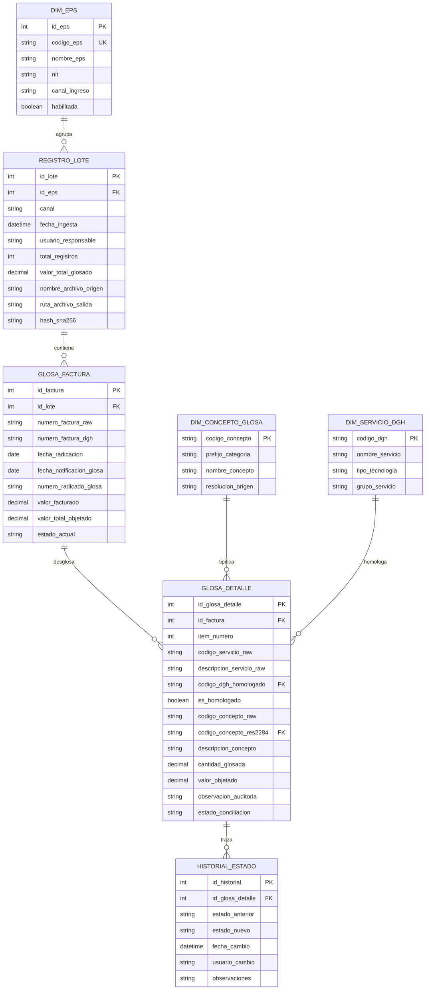

# Plan de Implementación: Base de Datos de Trazabilidad de Glosas y Dashboard Analítico

## 1. Visión del Objetivo

Actualmente, **Glosaap** procesa y homologa glosas de correos (IMAP) y portales web generando archivos Excel de objeciones. Sin embargo, no existe una memoria histórica centralizada ni un repositorio analítico persistente para responder preguntas estratégicas del área de Cartera:
- ¿Cuántas glosas ingresan por mes/semana por cada EPS?
- ¿Cuál es el monto total objetado vs. valor facturado por EPS?
- ¿Cuáles son los motivos/conceptos de glosa más frecuentes (Res. 2284: `TA`, `AU`, `SO`, etc.)?
- ¿Qué servicios médicos o insumos (CUPS / CUM) concentran el mayor volumen de glosas?
- ¿Cuál es la tasa de homologación y la eficiencia de respuesta en el tiempo?

Este plan propone el diseño exhaustivo de:
1. **Base de Datos Relacional de Trazabilidad:** Modelo de datos para registrar lotes de ingesta, facturas, detalles de glosas, homologaciones y ciclo de vida de respuestas.
2. **Dashboard Ejecutivo y Operativo:** Vista interactiva moderna dentro de Glosaap (o conectable vía BI/SQL) con KPIs, gráficas comparativas por EPS y filtros temporales.

---

## 2. Modelo de Base de Datos Propuesto

### 2.1 Elección de Motor
- **Fase Inicial / Standalone:** **SQLite 3** local o centralizado en recurso de red (`\\MINERVA\Cartera\GLOSAAP\DB\glosaap_trazabilidad.db`), con WAL mode (Write-Ahead Logging) activado para concurrencia segura sin infraestructura adicional.
- **Fase Empresarial / Multi-usuario:** **PostgreSQL** o **SQL Server** corporativo (conectado mediante SQLAlchemy en Glosaap).

---

### 2.2 Diagrama Entidad-Relación (ERD)



---

### 2.3 Especificación de Tablas y Campos

#### Tabla 1: `DIM_EPS` (Catálogo de Entidades)
| Campo | Tipo | Nulo | Descripción |
|---|---|:---:|---|
| `id_eps` | INTEGER PK AUTO | No | Identificador único de la EPS |
| `codigo_eps` | VARCHAR(20) | No | Clave unívoca (`mutualser`, `coosalud`, `sanitas`, `previsora`, `fomag`, `familiar`) |
| `nombre_eps` | VARCHAR(100) | No | Nombre comercial oficial de la entidad |
| `nit` | VARCHAR(20) | Sí | NIT de la entidad pagadora |
| `canal_ingreso` | VARCHAR(20) | No | `IMAP` o `WEB_SCRAPER` |
| `habilitada` | BOOLEAN | No | Indicador activo/inactivo (Default: `TRUE`) |

#### Tabla 2: `REGISTRO_LOTE` (Trazabilidad de Ingestas y Procesamientos)
*Registra cada corrida de descarga/procesamiento en Glosaap, permitiendo auditoría completa del origen.*
| Campo | Tipo | Nulo | Descripción |
|---|---|:---:|---|
| `id_lote` | INTEGER PK AUTO | No | Identificador del lote de procesamiento |
| `id_eps` | INTEGER FK | No | Referencia a `DIM_EPS.id_eps` |
| `canal` | VARCHAR(30) | No | `IMAP_CORREO`, `WEB_HORUS`, `WEB_FAMILIAR`, `MANUAL` |
| `fecha_ingesta` | DATETIME | No | Fecha/hora exacta de procesamiento en la app |
| `usuario_responsable` | VARCHAR(100) | No | Usuario del sistema o Windows (`%USERNAME%`) |
| `total_registros` | INTEGER | No | Conteo de líneas de glosa encontradas |
| `registros_homologados` | INTEGER | No | Conteo de líneas con código DGH asignado |
| `valor_total_glosado` | DECIMAL(15,2) | No | Suma acumulada de `CROVALOBJ` en el lote |
| `nombre_archivo_origen`| VARCHAR(255) | Sí | Nombre del Excel/PDF procesado |
| `ruta_archivo_objeciones`| VARCHAR(500) | Sí | Ruta completa del `Objeciones_*.xlsx` generado |
| `hash_sha256` | VARCHAR(64) | Sí | Hash anti-duplicados del archivo origen |

#### Tabla 3: `GLOSA_FACTURA` (Cuentas Médicas / Facturas Objetadas)
*Nivel de encabezado por factura/cuenta de cobro.*
| Campo | Tipo | Nulo | Descripción |
|---|---|:---:|---|
| `id_factura` | INTEGER PK AUTO | No | Identificador interno de la factura |
| `id_lote` | INTEGER FK | No | Referencia al lote de ingesta |
| `numero_factura_raw` | VARCHAR(50) | No | Factura tal como vino de la EPS (ej. `51234`, `FC 51234`) |
| `numero_factura_dgh` | VARCHAR(50) | No | Factura formateada para Dinámica (`FC000051234`) |
| `fecha_notificacion_glosa`| DATE | No | Fecha del correo o auditoría (`CROFECOBJ`) |
| `numero_radicado_glosa`| VARCHAR(100) | Sí | Número de radicado emitido por la EPS |
| `valor_total_objetado` | DECIMAL(15,2) | No | Total objetado acumulado de la factura |
| `estado_actual` | VARCHAR(30) | No | `RECIBIDA`, `OBJETADA_DGH`, `RESPONDIDA`, `CONCILIADA` |

#### Tabla 4: `GLOSA_DETALLE` (Líneas de Servicios e Ítems Objetados)
*El corazón analítico. Cada servicio médico, insumo o procedimiento objetado.*
| Campo | Tipo | Nulo | Descripción |
|---|---|:---:|---|
| `id_glosa_detalle` | INTEGER PK AUTO | No | Identificador único de la línea de glosa |
| `id_factura` | INTEGER FK | No | Referencia a `GLOSA_FACTURA.id_factura` |
| `item_numero` | INTEGER | No | Consecutivo de línea dentro de la factura (`CDCONSEC`) |
| `codigo_servicio_raw` | VARCHAR(50) | No | Código facturado original (`Tecnología`, `CUM`, etc.) |
| `descripcion_servicio_raw`| VARCHAR(255) | Sí | Nombre del procedimiento/medicamento |
| `codigo_dgh_homologado`| VARCHAR(50) | Sí | Código final homologado (`SLNSERPRO`) |
| `es_homologado` | BOOLEAN | No | `TRUE` si hubo match; `FALSE` si quedó en blanco/original |
| `codigo_concepto_raw` | VARCHAR(20) | Sí | Código concepto original de la EPS |
| `codigo_concepto_res2284`| VARCHAR(10) | Sí | Código estándar Res. 2284 (`CRNCONOBJ`: `TA0301`, `AU01`, etc.) |
| `cantidad_glosada` | DECIMAL(10,2) | Sí | Cantidad objetada |
| `valor_objetado` | DECIMAL(15,2) | No | Importe monetario exacto objetado (`CROVALOBJ`) |
| `observacion_auditoria`| TEXT | Sí | Texto de justificación de la EPS (`CRDOBSERV`) |
| `estado_conciliacion` | VARCHAR(30) | No | `PENDIENTE`, `ACEPTADA_IPS`, `DEFENDIDA`, `LEVANTADA` |

#### Tabla 5: `DIM_CONCEPTO_GLOSA` (Resolución 2284 / Normativa)
| Campo | Tipo | Descripción |
|---|---|---|
| `codigo_concepto` | VARCHAR(10) PK | Código estándar de 6 caracteres (ej. `TA0301`, `AU2103`, `SO4801`) |
| `prefijo_categoria`| VARCHAR(2) | `FA` (Facturación), `TA` (Tarifas), `SO` (Soportes), `AU` (Autorización), `CO` (Cobertura), `CL` (Pertinencia) |
| `nombre_concepto` | VARCHAR(200) | Descripción oficial del motivo de glosa |

---

## 3. Diseño del Dashboard Analítico

Se integrará una nueva vista en Glosaap: **Dashboard de Trazabilidad & Métricas** (disponible desde el menú principal de navegación con ruta `dashboard_metrics`).

```mermaid
flowchart TD
    subgraph Filtros Superiores
        F1["Rango Temporal: Desde / Hasta"] --- F2["Selector EPS: Todas / Específica"] --- F3["Estado: Todas / Pendientes"]
    end

    subgraph Tarjetas KPI Principales
        K1["💰 Total Monto Glosado\n$ 1.450.820.000"]
        K2["📋 Total Glosas\n4.821 líneas"]
        K3["🏥 Facturas Afectadas\n312 facturas"]
        K4["🎯 % Homologación\n94.8 %"]
    end

    subgraph Gráficas Analíticas
        G1["📊 Gráfica 1: Volumen y Monto por EPS (Bar / Donut)"]
        G2["🥧 Gráfica 2: Top 5 Categorías Res. 2284 (Tarifas vs Soportes vs Auditoría)"]
        G3["📈 Gráfica 3: Evolución Temporal Semanal/Mensual"]
        G4["📋 Tabla Top 10: Servicios Más Glosados (CUPS / CUM)"]
    end

    Filtros Superiores --> Tarjetas KPI Principales
    Tarjetas KPI Principales --> Gráficas Analíticas
```

### 3.1 Indicadores Clave de Desempeño (KPIs)
1. **Monto Total Objetado ($):** Suma total de `valor_objetado` en el periodo filtrado.
2. **Volumen de Glosas:** Cantidad de líneas/ítems objetados ingresados.
3. **Cuentas Médicas Impactadas:** Número de facturas únicas con al menos una glosa.
4. **Tasa de Cobertura de Homologación (%):**  
   $$\text{Tasa} = \left(\frac{\text{Líneas Homologadas}}{\text{Total Líneas}}\right) \times 100$$
5. **EPS de Mayor Impacto Financiero:** Identificación automática de la entidad con mayor deuda/objeción acumulada.

### 3.2 Vistas Gráficas en Flet
- **Gráfica de Barras / Distribución por EPS:** Comparativo de dinero objetado entre Mutualser, Coosalud, Sanitas, Previsora y Fomag.
- **Gráfica de Torta / Categorías de Glosa:** Porcentaje de glosas según el prefijo de la Res. 2284:
  - `TA`: Tarifas (diferencias de precios, manual tarifario)
  - `AU`: Autorizaciones (falta de autorización, servicio no autorizado)
  - `SO`: Soportes (falta historia clínica, epicrisis, hoja de gasto)
  - `FA`: Facturación (errores de radicación, datos de paciente)
  - `CL` / `CO`: Pertinencia clínica y cobertura
- **Top 10 Servicios Más Glosados:** Tabla con código, descripción, frecuencia de glosas y monto acumulado para alertar a Facturación y Auditoría Médica previa.

---

## 4. Plan de Implementación por Fases

> [!IMPORTANT]
> **Fase 1 (Base de Datos & Repositorio SQLite):** No interrumpe los flujos existentes de Glosaap. Se conecta de forma silenciosa para que cada vez que se procese una EPS (Mutualser, Coosalud, Sanitas, Previsora, Fomag), los resultados se inserten automáticamente en la base de datos local/red.
> 
> **Fase 2 (Capa de Servicio de Consultas y Estadísticas):** Creación de métodos de agregación rápida (sumas, agrupamientos por EPS, rankings).
> 
> **Fase 3 (UI Flet Dashboard):** Pantalla interactiva en Glosaap con selectores, tarjetas KPI y renderizado de gráficos/tablas.

### Componentes de Código a Desarrollar:
1. `app/database/connection.py`: Gestión de conexión SQLite (con soporte a pooling y modo WAL para red `\\MINERVA`).
2. `app/database/models.py`: Esquema de base de datos relacional DDL / ORM liviano.
3. `app/database/repository.py`: Métodos de guardado transaccional `guardar_lote_glosa(...)` y consultas analíticas `obtener_metricas_dashboard(...)`.
4. `app/service/analytics_service.py`: Servicio intermedio de cálculo de KPIs y agrupamientos.
5. Inyección en los procesadores (`MutualserProcessor`, `CoosaludProcessor`, `SanitasProcessor`, `PrevisoraProcessor`, `FomagProcessor`) para registrar automáticamente el lote al generar las objeciones.
6. `app/ui/views/metrics_view.py`: Pantalla de Flet con gráficos, selectores de fecha y exportación de reportes consolidados en Excel/PDF.

---

## 5. Preguntas de Alineación para el Usuario

> [!TIP]
> Por favor revisa estos 3 puntos para afinar el diseño antes de comenzar a escribir código:
> 1. **Ubicación de la Base de Datos:** ¿Prefieres que el archivo de base de datos resida en la red compartida (`\\MINERVA\Cartera\GLOSAAP\DB\glosaap.db`) para que cualquier computador con Glosaap lea y alimente las mismas métricas centralizadas, o prefieres una base de datos local por equipo?
> 2. **Histórico Inicial:** ¿Te gustaría incluir un script de carga inicial ("migrador histórico") que lea los archivos de `REPOSITORIO DE RESULTADOS` anteriores para poblar la base de datos con los meses pasados?
> 3. **Estados de Conciliación:** ¿Deseas que desde el dashboard se pueda cambiar el estado de una factura (ej. marcarla como `RESPONDIDA` o `LEVANTADA`), o inicialmente solo trazabilidad de lo que ingresa?
