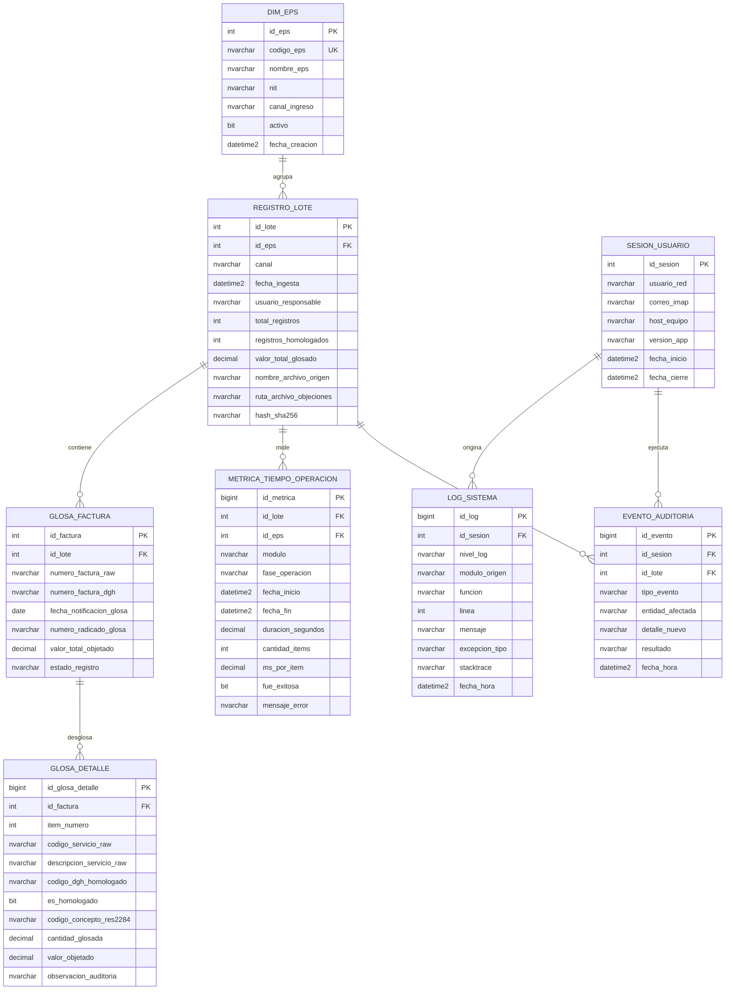

# Propuesta de Arquitectura: Base de Datos en SQL Server para Trazabilidad de Glosas, Métricas de Tiempo y Auditoría

> **Versión:** 2.0 (SQL Server Enterprise / Observabilidad Integral)  
> **Fecha:** 2026-11-18  
> **Motor:** Microsoft SQL Server (T-SQL)  
> **Aplicación:** Glosaap — Cartera / Glosas (Clínica La Concepción)

---

## 1. Visión y Objetivos

Actualmente, **Glosaap** automatiza el ciclo operativo de búsqueda IMAP, descarga web, homologación de códigos y generación de archivos Excel de objeciones. Esta propuesta formaliza el diseño de la **Base de Datos Corporativa en Microsoft SQL Server** para proporcionar:

1. **Memoria Histórica y Trazabilidad de Glosas:** Centralizar cada factura, servicio objetado, concepto de la Resolución 2284, valor glosado y homologación DGH realizada.
2. **Telemetría y Métricas de Tiempos Operacionales:** Cuantificar la duración exacta (segundos y $\text{ms/item}$) de cada fase del flujo (`BUSQUEDA_IMAP`, `DESCARGA_ADJUNTOS`, `EXTRACCION_DATOS`, `CRUCE_HOMOLOGACION`, `EXPORTACION_OBJECIONES`, `TRAMO_SCRAPING_WEB`) para detectar cuellos de botella de red y cómputo.
3. **Auditoría Técnica y Logs Estructurados:** Registrar eventos de la aplicación, excepciones, stacktraces y modificaciones sobre maestros de homologación para soporte y control.
4. **Dashboard Analítico:** Consultas SQL consolidadas para alimentar la interfaz visual de Glosaap y herramientas de BI con KPIs de negocio y salud del sistema.

---

## 2. Decisiones de Diseño y Alcance Inicial

- **Motor Seleccionado:** **Microsoft SQL Server** con sintaxis nativa T-SQL (`INT IDENTITY`, `BIGINT`, `NVARCHAR`, `DATETIME2(3)`, `DECIMAL(18,2)`, índices no agrupados para búsquedas analíticas y restricciones de integridad).
- **Carga Histórica:** Postergada para una fase posterior; el sistema iniciará capturando en tiempo real las operaciones en curso.
- **Flujo de Estados:** **Inmutable en fase inicial.** El sistema registra las glosas tal como se notifican y procesan, sin cambios manuales interactivos de estado desde el dashboard por el momento.

---

## 3. Diagrama Entidad-Relación (ERD)



---

## 4. Esquema DDL en Microsoft SQL Server (T-SQL)

### 4.1 Módulo de Glosas y Trazabilidad

```sql
-- ==========================================================
-- 1. TABLA: DIM_EPS (Catálogo de Entidades)
-- ==========================================================
CREATE TABLE dbo.DIM_EPS (
    id_eps INT IDENTITY(1,1) PRIMARY KEY,
    codigo_eps NVARCHAR(30) NOT NULL UNIQUE, -- 'mutualser', 'coosalud', 'sanitas', 'previsora', 'fomag', 'familiar'
    nombre_eps NVARCHAR(100) NOT NULL,
    nit NVARCHAR(20) NULL,
    canal_ingreso NVARCHAR(20) NOT NULL,     -- 'IMAP', 'WEB_SCRAPER'
    activo BIT NOT NULL DEFAULT 1,
    fecha_creacion DATETIME2(3) NOT NULL DEFAULT SYSDATETIME()
);

-- ==========================================================
-- 2. TABLA: REGISTRO_LOTE (Lotes de Ingesta / Procesamiento)
-- ==========================================================
CREATE TABLE dbo.REGISTRO_LOTE (
    id_lote INT IDENTITY(1,1) PRIMARY KEY,
    id_eps INT NOT NULL FOREIGN KEY REFERENCES dbo.DIM_EPS(id_eps),
    canal NVARCHAR(30) NOT NULL,             -- 'IMAP_CORREO', 'WEB_HORUS', 'WEB_FAMILIAR', 'MANUAL'
    fecha_ingesta DATETIME2(3) NOT NULL DEFAULT SYSDATETIME(),
    usuario_responsable NVARCHAR(100) NOT NULL,
    total_registros INT NOT NULL DEFAULT 0,
    registros_homologados INT NOT NULL DEFAULT 0,
    valor_total_glosado DECIMAL(18,2) NOT NULL DEFAULT 0.00,
    nombre_archivo_origen NVARCHAR(260) NULL,
    ruta_archivo_objeciones NVARCHAR(500) NULL,
    hash_sha256 NVARCHAR(64) NULL,           -- Control de deduplicación
    CONSTRAINT CK_Lote_Total CHECK (total_registros >= 0)
);
CREATE NONCLUSTERED INDEX IX_Lote_EpsFecha ON dbo.REGISTRO_LOTE (id_eps, fecha_ingesta DESC);

-- ==========================================================
-- 3. TABLA: GLOSA_FACTURA (Encabezados por Cuenta Médica)
-- ==========================================================
CREATE TABLE dbo.GLOSA_FACTURA (
    id_factura INT IDENTITY(1,1) PRIMARY KEY,
    id_lote INT NOT NULL FOREIGN KEY REFERENCES dbo.REGISTRO_LOTE(id_lote),
    numero_factura_raw NVARCHAR(50) NOT NULL,
    numero_factura_dgh NVARCHAR(50) NOT NULL,  -- FC0000{dígitos}
    fecha_notificacion_glosa DATE NOT NULL,
    numero_radicado_glosa NVARCHAR(100) NULL,
    valor_total_objetado DECIMAL(18,2) NOT NULL DEFAULT 0.00,
    estado_registro NVARCHAR(30) NOT NULL DEFAULT 'REGISTRADA' -- 'REGISTRADA', 'PROCESADA'
);
CREATE NONCLUSTERED INDEX IX_Factura_DGH ON dbo.GLOSA_FACTURA (numero_factura_dgh);
CREATE NONCLUSTERED INDEX IX_Factura_Fecha ON dbo.GLOSA_FACTURA (fecha_notificacion_glosa);

-- ==========================================================
-- 4. TABLA: GLOSA_DETALLE (Líneas de Servicios Objetados)
-- ==========================================================
CREATE TABLE dbo.GLOSA_DETALLE (
    id_glosa_detalle BIGINT IDENTITY(1,1) PRIMARY KEY,
    id_factura INT NOT NULL FOREIGN KEY REFERENCES dbo.GLOSA_FACTURA(id_factura),
    item_numero INT NOT NULL,                  -- CDCONSEC (1, 2, 3...)
    codigo_servicio_raw NVARCHAR(50) NOT NULL,  -- Código prestador / CUM / ERP
    descripcion_servicio_raw NVARCHAR(300) NULL,
    codigo_dgh_homologado NVARCHAR(50) NULL,    -- SLNSERPRO (DGH)
    es_homologado BIT NOT NULL DEFAULT 0,
    codigo_concepto_res2284 NVARCHAR(10) NULL,  -- CRNCONOBJ (TA0301, AU01, etc.)
    cantidad_glosada DECIMAL(10,2) NULL,
    valor_objetado DECIMAL(18,2) NOT NULL DEFAULT 0.00, -- CROVALOBJ
    observacion_auditoria NVARCHAR(MAX) NULL
);
CREATE NONCLUSTERED INDEX IX_Detalle_Factura ON dbo.GLOSA_DETALLE (id_factura);
CREATE NONCLUSTERED INDEX IX_Detalle_Concepto ON dbo.GLOSA_DETALLE (codigo_concepto_res2284);
CREATE NONCLUSTERED INDEX IX_Detalle_Servicio ON dbo.GLOSA_DETALLE (codigo_dgh_homologado);
```

---

### 4.2 Módulo de Telemetría, Logs y Auditoría

```sql
-- ==========================================================
-- 5. TABLA: SESION_USUARIO (Trazabilidad de Estaciones)
-- ==========================================================
CREATE TABLE dbo.SESION_USUARIO (
    id_sesion INT IDENTITY(1,1) PRIMARY KEY,
    usuario_red NVARCHAR(100) NOT NULL,         -- %USERNAME%
    correo_imap NVARCHAR(150) NULL,
    host_equipo NVARCHAR(100) NOT NULL,         -- %COMPUTERNAME%
    version_app NVARCHAR(20) NOT NULL,          -- APP_VERSION
    fecha_inicio DATETIME2(3) NOT NULL DEFAULT SYSDATETIME(),
    fecha_cierre DATETIME2(3) NULL
);

-- ==========================================================
-- 6. TABLA: METRICA_TIEMPO_OPERACION (Telemetría de Tiempos)
-- ==========================================================
CREATE TABLE dbo.METRICA_TIEMPO_OPERACION (
    id_metrica BIGINT IDENTITY(1,1) PRIMARY KEY,
    id_lote INT NULL FOREIGN KEY REFERENCES dbo.REGISTRO_LOTE(id_lote),
    id_eps INT NULL FOREIGN KEY REFERENCES dbo.DIM_EPS(id_eps),
    modulo NVARCHAR(50) NOT NULL,               -- 'IMAP_SERVICE', 'MUTUALSER', 'SANITAS', 'FOMAG_SCRAPER'
    fase_operacion NVARCHAR(50) NOT NULL,       -- 'BUSQUEDA_IMAP', 'DESCARGA_ADJUNTOS', 'HOMOLOGACION', 'EXPORTACION', 'TRAMO_SCRAPING_WEB'
    fecha_inicio DATETIME2(3) NOT NULL,
    fecha_fin DATETIME2(3) NOT NULL,
    duracion_segundos DECIMAL(10,3) NOT NULL,
    cantidad_items INT NOT NULL DEFAULT 0,
    ms_por_item DECIMAL(10,2) NULL,             -- Telemetría unitaria calculada
    fue_exitosa BIT NOT NULL DEFAULT 1,
    mensaje_error NVARCHAR(500) NULL
);
CREATE NONCLUSTERED INDEX IX_Metrica_ModuloFase ON dbo.METRICA_TIEMPO_OPERACION (modulo, fase_operacion, fecha_inicio DESC);

-- ==========================================================
-- 7. TABLA: LOG_SISTEMA (Logs Técnicos Estructurados)
-- ==========================================================
CREATE TABLE dbo.LOG_SISTEMA (
    id_log BIGINT IDENTITY(1,1) PRIMARY KEY,
    id_sesion INT NULL FOREIGN KEY REFERENCES dbo.SESION_USUARIO(id_sesion),
    nivel_log NVARCHAR(10) NOT NULL,            -- 'DEBUG', 'INFO', 'WARNING', 'ERROR', 'CRITICAL'
    modulo_origen NVARCHAR(100) NOT NULL,
    funcion NVARCHAR(100) NULL,
    linea INT NULL,
    mensaje NVARCHAR(MAX) NOT NULL,
    excepcion_tipo NVARCHAR(150) NULL,
    stacktrace NVARCHAR(MAX) NULL,
    fecha_hora DATETIME2(3) NOT NULL DEFAULT SYSDATETIME()
);
CREATE NONCLUSTERED INDEX IX_Log_NivelFecha ON dbo.LOG_SISTEMA (nivel_log, fecha_hora DESC);

-- ==========================================================
-- 8. TABLA: EVENTO_AUDITORIA (Seguridad y Modificaciones)
-- ==========================================================
CREATE TABLE dbo.EVENTO_AUDITORIA (
    id_evento BIGINT IDENTITY(1,1) PRIMARY KEY,
    id_sesion INT NOT NULL FOREIGN KEY REFERENCES dbo.SESION_USUARIO(id_sesion),
    id_lote INT NULL FOREIGN KEY REFERENCES dbo.REGISTRO_LOTE(id_lote),
    tipo_evento NVARCHAR(60) NOT NULL,          -- 'LOGIN', 'PROCESO_GLOSA', 'CREAR_CODIGO_HOMOLOGO', 'MODIFICAR_MAESTRO', 'BACKUP'
    entidad_afectada NVARCHAR(150) NULL,
    detalle_nuevo NVARCHAR(MAX) NULL,
    resultado NVARCHAR(20) NOT NULL DEFAULT 'EXITOSO',
    fecha_hora DATETIME2(3) NOT NULL DEFAULT SYSDATETIME()
);
```

---

## 5. Consultas Analíticas para el Dashboard

### 5.1 Tarjetas Principales (KPIs Globales)
```sql
SELECT 
    COUNT(DISTINCT f.id_factura) AS total_facturas_glosadas,
    COUNT(d.id_glosa_detalle) AS total_lineas_glosa,
    SUM(d.valor_objetado) AS monto_total_objetado,
    ROUND(CAST(SUM(CASE WHEN d.es_homologado = 1 THEN 1 ELSE 0 END) AS FLOAT) / 
          NULLIF(COUNT(d.id_glosa_detalle), 0) * 100, 2) AS tasa_homologacion_pct
FROM dbo.GLOSA_DETALLE d
INNER JOIN dbo.GLOSA_FACTURA f ON d.id_factura = f.id_factura
INNER JOIN dbo.REGISTRO_LOTE l ON f.id_lote = l.id_lote
WHERE l.fecha_ingesta >= DATEADD(MONTH, -1, SYSDATETIME());
```

### 5.2 Distribución de Glosas por EPS
```sql
SELECT 
    e.nombre_eps,
    COUNT(DISTINCT f.id_factura) AS facturas,
    COUNT(d.id_glosa_detalle) AS lineas_glosa,
    SUM(d.valor_objetado) AS valor_total_glosado,
    ROUND(AVG(d.valor_objetado), 2) AS ticket_promedio_glosa
FROM dbo.DIM_EPS e
INNER JOIN dbo.REGISTRO_LOTE l ON e.id_eps = l.id_eps
INNER JOIN dbo.GLOSA_FACTURA f ON l.id_lote = f.id_lote
INNER JOIN dbo.GLOSA_DETALLE d ON f.id_factura = d.id_factura
WHERE l.fecha_ingesta >= DATEADD(MONTH, -1, SYSDATETIME())
GROUP BY e.nombre_eps
ORDER BY valor_total_glosado DESC;
```

### 5.3 Top 10 Conceptos de Glosa (Resolución 2284)
```sql
SELECT TOP 10 
    COALESCE(d.codigo_concepto_res2284, 'SIN_CONCEPTO') AS concepto_glosa,
    COUNT(d.id_glosa_detalle) AS frecuencia_glosa,
    SUM(d.valor_objetado) AS valor_acumulado
FROM dbo.GLOSA_DETALLE d
GROUP BY d.codigo_concepto_res2284
ORDER BY valor_acumulado DESC;
```

### 5.4 Telemetría de Rendimiento Operativo y Tasa de Éxito
```sql
SELECT 
    modulo,
    fase_operacion,
    COUNT(id_metrica) AS total_ejecuciones,
    ROUND(AVG(duracion_segundos), 2) AS tiempo_promedio_segundos,
    ROUND(AVG(ms_por_item), 2) AS promedio_ms_por_item,
    SUM(CASE WHEN fue_exitosa = 1 THEN 1 ELSE 0 END) * 100.0 / COUNT(id_metrica) AS tasa_exito_pct
FROM dbo.METRICA_TIEMPO_OPERACION
WHERE fecha_inicio >= DATEADD(DAY, -30, SYSDATETIME())
GROUP BY modulo, fase_operacion
ORDER BY modulo, fase_operacion;
```

---

## 6. Siguientes Pasos de Implementación

1. **Configuración de Conexión en `app/config/settings.py`:**
   - Parámetros de host SQL Server, puerto, base de datos y autenticación Windows integrada o credenciales cifradas con `keyring`.
2. **Capa de Conexión (`pyodbc` o `SQLAlchemy`):**
   - Pool de conexiones seguro con reconexión automática en caso de cortes de red.
3. **Decorador de Telemetría `@medir_tiempo`:**
   - Inserción asíncrona o por lotes de registros en `METRICA_TIEMPO_OPERACION` y `LOG_SISTEMA`.
4. **Alimentación Automática en Procesadores:**
   - Llamada transaccional al finalizar `save_result()` para persistir el lote en SQL Server sin interrumpir la entrega del archivo Excel.
